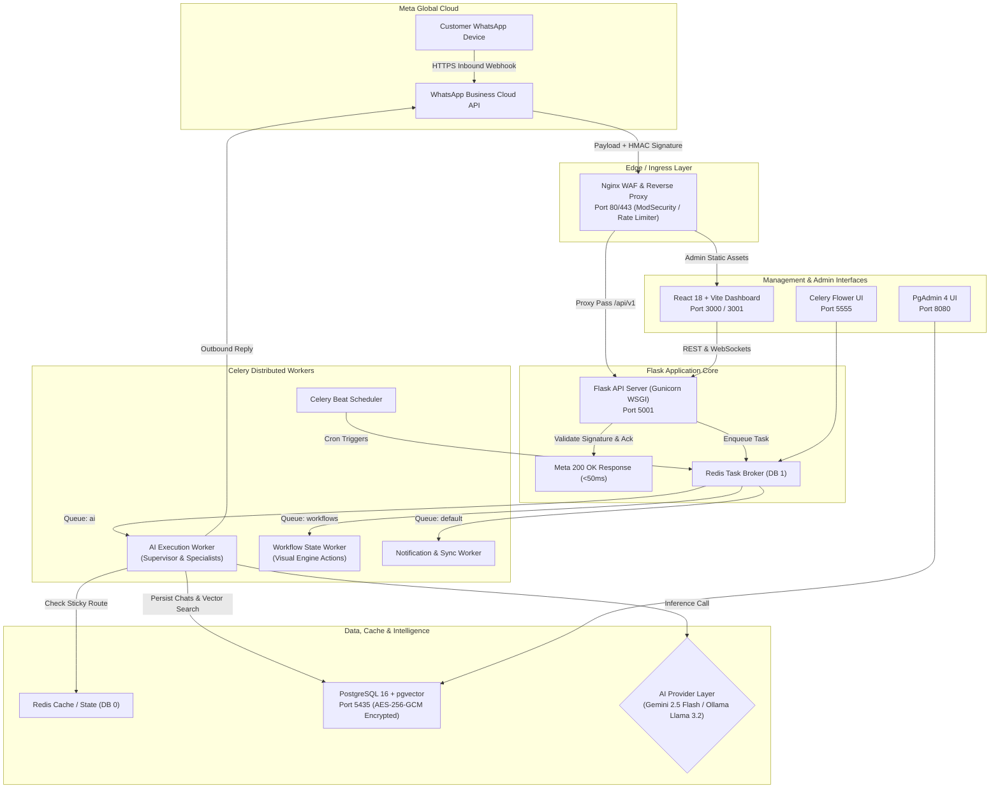
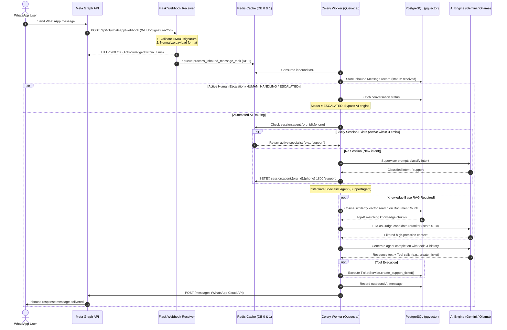
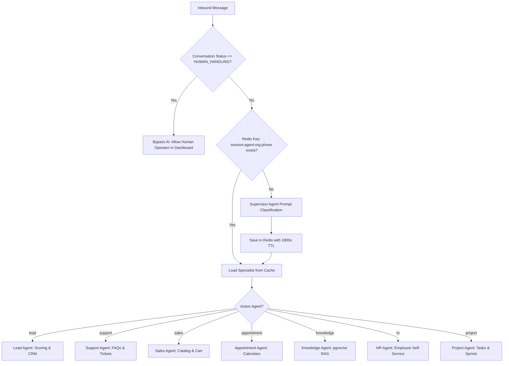
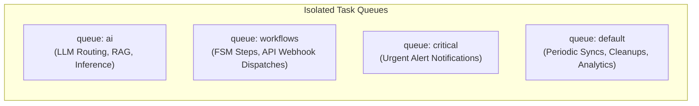
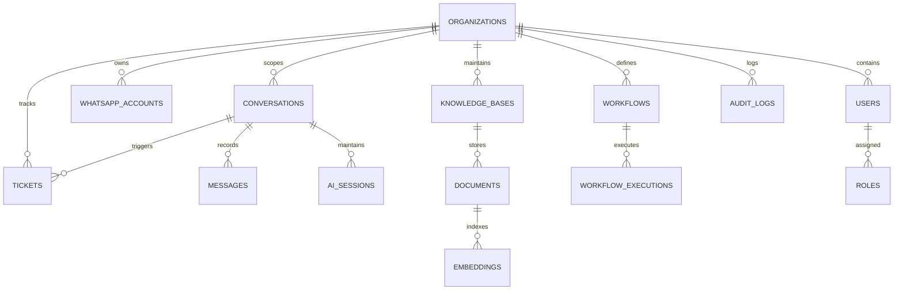

# 🤖 Enterprise AI WhatsApp Automation Platform

> **Production-ready, multi-tenant AI-powered WhatsApp Automation & Business Orchestration Platform** featuring a **Supervisor-Specialist Multi-Agent System**, **Local RAG with `pgvector` & LLM-as-Judge Reranking**, **Visual Declarative Workflow Engine**, **Zero-Drop Sub-50ms Async Webhook Ingestion**, and **Transparent AES-256-GCM Database Encryption**.

---

[](https://python.org)
[](https://flask.palletsprojects.com)
[](https://react.dev)
[](https://vitejs.dev)
[](https://nextjs.org)
[](https://docs.celeryq.dev)
[](https://redis.io)
[](https://postgresql.org)
[](https://docker.com)
[](#)

---

## 📑 Table of Contents

- [Executive Summary](#-executive-summary)
- [System Architecture](#-system-architecture)
  - [High-Level Topology](#high-level-topology)
  - [End-to-End Message Processing Lifecycle](#end-to-end-message-processing-lifecycle)
- [Core Technological Innovations](#-core-technological-innovations)
  - [1. Supervisor-Specialist Multi-Agent System](#1-supervisor-specialist-multi-agent-system)
  - [2. High-Performance Local RAG with `pgvector` & LLM Reranking](#2-high-performance-local-rag-with-pgvector--llm-reranking)
  - [3. Sub-50ms Asynchronous Ingestion & Meta SLA Engine](#3-sub-50ms-asynchronous-ingestion--meta-sla-engine)
  - [4. Transparent AES-256-GCM Column-Level DB Encryption](#4-transparent-aes-256-gcm-column-level-db-encryption)
  - [5. Hybrid Declarative & Agentic Workflow Engine](#5-hybrid-declarative--agentic-workflow-engine)
  - [6. Real-Time Human Handoff & Auto-Bypass Routing](#6-real-time-human-handoff--auto-bypass-routing)
- [Multi-Agent Registry & Capabilities](#-multi-agent-registry--capabilities)
- [Asynchronous Queues & Background Workers](#-asynchronous-queues--background-workers)
- [Database Schema & Data Model](#-database-schema--data-model)
- [Frontend Dashboards & Portals](#-frontend-dashboards--portals)
- [REST API Specification](#-rest-api-specification)
- [Project Directory Structure](#-project-directory-structure)
- [Quick Start Guide](#-quick-start-guide)
  - [Prerequisites](#prerequisites)
  - [Docker Compose Quickstart (Recommended)](#docker-compose-quickstart-recommended)
  - [Local Manual Development Setup](#local-manual-development-setup)
- [Service Directory & Port Matrix](#-service-directory--port-matrix)
- [Environment Configuration (.env)](#-environment-configuration-env)
- [Developer CLI (Makefile Reference)](#-developer-cli-makefile-reference)
- [Testing, QA & Security Audits](#-testing-qa--security-audits)
- [Production Deployment & Monitoring](#-production-deployment--monitoring)
- [License & Support](#-license--support)

---

## 🌟 Executive Summary

The **AI WhatsApp Automation Platform** is an enterprise-ready SaaS suite engineered to run high-volume, contextual customer communications on WhatsApp. Unlike basic rule-based chatbots or unconstrained single-LLM wrappers, this platform provides:

- **Specialist Multi-Agent Architecture**: Dedicated agents with distinct domain tools and prompts (Sales, Support, Lead Qualification, Appointments, Knowledge, HR, Projects) coordinated by a Supervisor router.
- **Sticky Session Optimization**: Redis-cached routing locks incoming sessions for 30 minutes, cutting classification overhead and saving ~500ms latency plus LLM token costs per turn.
- **Resilient Zero-Drop Webhook Pipeline**: Immediate Meta HMAC verification and sub-50ms `200 OK` return meeting strict Meta SLAs, passing full payload execution into Celery queues.
- **Transparent Data-at-Rest Security**: AES-256-GCM encryption implemented through custom SQLAlchemy `TypeDecorator` objects for seamless column-level encryption of tenant access tokens without altering query interfaces.
- **Enterprise Operations GUI**: 15 administrative console pages in a reactive React/Vite dashboard with live conversation feeds, ticket desks, and workflow designers.

---

## 🏗️ System Architecture

### High-Level Topology



---

### End-to-End Message Processing Lifecycle

The diagram below details the journey of an inbound WhatsApp message from client dispatch to outbound AI delivery:



---

## 🔑 Core Technological Innovations

### 1. Supervisor-Specialist Multi-Agent System
- **Context Bleed Elimination**: Monolithic single-prompt bots suffer from prompt injection and instructions bleeding across domains. Our platform decomposes responsibilities into dedicated agent classes inheriting from [`BaseAgent`](file:///Users/dakshabordekar/Whatsapp-Bot/backend/app/agents/base_agent.py).
- **Session Locking Engine**: When a customer initiates a dialog, [`AgentRouter`](file:///Users/dakshabordekar/Whatsapp-Bot/backend/app/ai/orchestrator/router.py) checks Redis. If a sticky route exists, the supervisor classification LLM call is bypassed. This drops response times by ~500ms and cuts input token costs.



### 2. High-Performance Local RAG with `pgvector` & LLM Reranking
- **Zero Third-Party Data Exfiltration**: Embeddings are stored natively in PostgreSQL using the `pgvector` extension.
- **Two-Tier Precision Engine**:
  1. **Tier 1 (Dense Vector Retrieval)**: Fast cosine distance retrieval using HNSW/IVFFlat indexing to fetch Top-$K$ candidate chunks.
  2. **Tier 2 (LLM-as-Judge Reranking)**: A specialized reranker (`reranker.py`) scores retrieved snippets on a strict 0–10 scale against the customer query, discarding hallucinations and noise before prompt injection.

```mermaid
flowchart LR
    Doc[PDF/Doc Ingestion] --> Chunker[Semantic Chunker]
    Chunker --> Embedder[Embedding Generator]
    Embedder --> PGVector[(PostgreSQL pgvector)]
    
    Query[User WhatsApp Query] --> QEmbed[Embedding Generator]
    QEmbed --> VectorSearch[Top-K Cosine Search]
    PGVector --> VectorSearch
    VectorSearch --> Reranker[LLM-as-Judge Reranker (0-10)]
    Reranker --> FinalPrompt[Augmented Context Prompt]
    FinalPrompt --> LLM[Specialist Agent Completion]
```

### 3. Sub-50ms Asynchronous Ingestion & Meta SLA Engine
- Meta enforces a strict **5-second timeout** on incoming webhook notifications before flagging endpoints as degraded and initiating retries.
- Webhooks hitting `/api/v1/whatsapp/webhook` execute signature verification via `X-Hub-Signature-256`, normalize JSON payloads into standard schemas, enqueue processing to Redis via Celery, and immediately return HTTP `200 OK` in `<50ms`.

### 4. Transparent AES-256-GCM Column-Level DB Encryption
- Tenant credentials (such as Meta WhatsApp Cloud API access tokens, client keys, and secrets) are encrypted before reaching the disk.
- Utilizes an SQLAlchemy [`TypeDecorator`](file:///Users/dakshabordekar/Whatsapp-Bot/backend/app/models/whatsapp_account.py) named `EncryptedText`.
- Whenever a record is saved, `EncryptionService.encrypt()` appends a unique 12-byte random initialization vector (nonce), computes an authenticated AES-GCM ciphertext, and stores it in Base64 format. Decryption occurs transparently on model access.

```
Plaintext Token ──> [AES-256-GCM + 12-byte Random Nonce] ──> Base64 Ciphertext ──> PostgreSQL
Plaintext Token <── [AES-256-GCM Authenticated Decrypt]  <── Base64 Ciphertext <── PostgreSQL
```

### 5. Hybrid Declarative & Agentic Workflow Engine
- Visual and programmable business logic handled by a deterministic Finite State Machine (FSM).
- Supports execution states: `PENDING` ➔ `RUNNING` ➔ `COMPLETED` or `FAILED`.
- **Prebuilt Step Executors**:
  - `send_message`: Dispatches template or free-form text through the Meta Cloud API.
  - `create_ticket`: Creates prioritized helpdesk records linked to conversation history.
  - `update_context`: Modifies conversational memory variables.
  - `wait`: Pauses execution until a callback or timeout occurs.

### 6. Real-Time Human Handoff & Auto-Bypass Routing
- Conversations can transition to `HUMAN_HANDLING` or `ESCALATED` either via AI agent intent detection or manual dashboard operator intervention.
- The `AgentRouter` inspects conversation states before dispatching any specialist; human-handled threads immediately skip the AI loop to prevent the bot from interrupting live agents.

---

## 🤖 Multi-Agent Registry & Capabilities

| Agent Name | Identifier | Primary Domain & Responsibility | Tools & Capabilities |
| :--- | :--- | :--- | :--- |
| **Supervisor** | `supervisor` | Inbound message intent classification & routing | Intent determination prompt, agent mapping table |
| **Lead Agent** | `lead` | Lead qualification, score grading, and CRM ingest | Lead form validation, qualification rules, CRM dispatch |
| **Support Agent** | `support` | Technical support, FAQs, and ticket escalation | Ticket creation, priority setting, escalation triggers |
| **Sales Agent** | `sales` | Catalog browsing, product recommendations, checkout | Catalog search, order calculation, purchase funnels |
| **Appointment Agent**| `appointment`| Consultation & booking management | Slot verification, schedule booking, calendar sync |
| **Knowledge Agent** | `knowledge` | Unstructured corporate documentation search | `pgvector` semantic retrieval, chunk reranking |
| **HR Agent** | `hr` | Employee self-service, leave requests, policies | Employee record lookup, leave balance, HR documentation |
| **Project Agent** | `project` | Project delivery tracking, sprint progress, milestones | Project milestone lookup, ticket status, deadline queries |

---

## ⚡ Asynchronous Queues & Background Workers

The platform runs on Celery with specialized task queues for concurrency isolation:



### Queue Breakdown

| Queue Name | Routing Key Pattern | Concurrency Profile | Tasks Executed |
| :--- | :--- | :--- | :--- |
| `ai` | `app.tasks.ai_tasks.*`, `queue_tasks.process_inbound_message_task` | Concurrency: 4 | Inbound message handling, agent routing, embedding generation |
| `workflows` | `app.tasks.workflow_tasks.*`, `queue_tasks.dispatch_endpoint_task` | Concurrency: 4 | Workflow step executions, outbound API webhooks |
| `critical` | `app.tasks.notification_tasks.send_critical_*` | Concurrency: 2 | System alerts, security notifications, SLA failure warnings |
| `default` | `app.tasks.*` | Concurrency: 2 | Daily analytics generation, session cleanups, sync tasks |

### Celery Beat (Periodic Automation Schedule)

| Schedule Job | Interval / Cron | Target Task Function | Objective |
| :--- | :--- | :--- | :--- |
| **Process Followups** | Every 5 minutes (`*/5 * * * *`) | `app.tasks.followup_tasks.process_due_followups` | Checks scheduled follow-ups and dispatches queued messages |
| **Clean Expired Sessions**| Daily at 02:00 UTC (`0 2 * * *`) | `app.tasks.cleanup_tasks.cleanup_expired_ai_sessions` | Purges expired Redis and DB conversational memory state |
| **Daily Analytics** | Daily at 01:00 UTC (`0 1 * * *`) | `app.tasks.analytics_tasks.compute_daily_metrics` | Computes response latency, message volume, and token usage |

---

## 🗄️ Database Schema & Data Model

The relational database architecture is built on PostgreSQL 16 with the `pgvector` extension across 29 models:



### Core Entity Summary

- **`Organization`**: Multi-tenant anchor. All tables contain an `organization_id` column ensuring strict row-level tenant boundary isolation.
- **`WhatsAppAccount`**: Holds Meta WABA configuration, Phone Number IDs, and the AES-256-GCM encrypted `access_token`.
- **`Conversation`**: Tracks contact telephone number, profile name, conversation status (`ACTIVE`, `HUMAN_HANDLING`, `ESCALATED`, `CLOSED`), and active specialist assignment.
- **`Message`**: Stores direction (`inbound`/`outbound`), raw text body, media metadata, Meta message IDs, and delivery statuses (`sent`, `delivered`, `read`, `failed`).
- **`Document` & `Embedding`**: Houses split text fragments paired with vector embeddings (stored as `vector(1536)` or `vector(768)`).
- **`Workflow` & `WorkflowExecution`**: Graph definition of actions, current step index, context payloads, and execution state history.
- **`Ticket`**: Support issues created during agent conversations with priority levels (`LOW`, `MEDIUM`, `HIGH`, `URGENT`).
- **`AuditLog`**: Immutable security log recording IP address, actor user ID, action verb, and timestamp for SOC2/ISO27001 readiness.

---

## 💻 Frontend Dashboards & Portals

The project includes two complementary frontend applications:

### 1. Enterprise Administration Portal (`frontend-vite/`)
A responsive Single Page Application built with **React 18**, **Vite**, **Tailwind CSS**, and **Radix UI**:
- **Port**: `3000` (Docker default) / `3001` (Local dev)
- **Live Conversations Feed**: Real-time WhatsApp operator console with typing indicators, manual takeover, and live message dispatch.
- **Agent Orchestrator Configurator**: Visual prompt editing, model provider hot-swapping, and temperature tuning.
- **15 Enterprise Views**:
  - `Dashboard`: Live throughput, queue status, active agents, and SLA metric counters.
  - `Conversations`: Searchable message histories, customer tags, and live intervention console.
  - `Tickets`: Drag-and-drop ticket boards, priority assignment, and conversation linking.
  - `Workflows`: Visual flowchart automation editor and run history monitor.
  - `Agents`: Specialist agent persona configuration and tool assignment.
  - `Prompts`: Version-controlled prompt library with test benches.
  - `Knowledge Base`: Document drag-and-drop ingestion with embedding status indicators.
  - `Analytics`: Token usage graphs, response latency percentiles, and resolution rates.
  - `Audit Logs`: Filterable security activity trail.
  - `Clients`, `Employees`, `Endpoints`, `Security`, `Settings`, `Users`.

### 2. Next.js Web Application (`frontend/`)
- Built on **Next.js 16** with **React 19**, **Tailwind CSS v4**, and **Framer Motion**.
- Designed for marketing pages, customer self-service, and authentication interfaces.

---

## 🔌 REST API Specification

All backend endpoints are prefixed with `/api/v1` and return structured JSON responses.

```
Response Format:
{
  "success": true,
  "data": { ... },
  "message": "Operation completed successfully"
}
```

### API Endpoint Directory

| Blueprint / Category | Method | Route | Description | Auth Required |
| :--- | :---: | :--- | :--- | :---: |
| **Authentication** | `POST` | `/api/v1/auth/login` | Authenticate user & issue access/refresh JWTs | No |
| | `POST` | `/api/v1/auth/refresh` | Exchange refresh token for new access token | Bearer Token |
| | `GET` | `/api/v1/auth/me` | Fetch active profile and permission tree | Bearer Token |
| **WhatsApp Webhook**| `GET` | `/api/v1/whatsapp/webhook` | Meta verification handshake (`hub.challenge`) | Verify Token |
| | `POST` | `/api/v1/whatsapp/webhook` | Inbound WhatsApp message/status payload ingestion | HMAC-SHA256 |
| | `GET` | `/api/v1/whatsapp/accounts`| List configured WhatsApp business accounts | Bearer Token |
| **Conversations** | `GET` | `/api/v1/conversations` | List tenant conversations (paginated, filterable)| Bearer Token |
| | `GET` | `/api/v1/conversations/{id}`| Fetch conversation details and context variables | Bearer Token |
| | `POST` | `/api/v1/conversations/{id}/handoff` | Transfer conversation to human or specialist | Bearer Token |
| **Messages** | `GET` | `/api/v1/messages` | Query message log for a conversation | Bearer Token |
| | `POST` | `/api/v1/messages/send` | Send outbound WhatsApp message to recipient | Bearer Token |
| **Agents** | `GET` | `/api/v1/agents` | List active specialist agent configurations | Bearer Token |
| | `PUT` | `/api/v1/agents/{name}`| Update agent system prompt, model, or tools | Bearer Token |
| **Workflows** | `GET` | `/api/v1/workflows` | List declarative visual workflows | Bearer Token |
| | `POST` | `/api/v1/workflows` | Create a new automated workflow definition | Bearer Token |
| | `POST` | `/api/v1/workflows/{id}/run`| Trigger manual execution of a workflow | Bearer Token |
| **Knowledge Base** | `GET` | `/api/v1/knowledge_base`| List document libraries and vector status | Bearer Token |
| | `POST` | `/api/v1/knowledge_base/upload` | Ingest PDF/Text document, chunk, and embed | Bearer Token |
| **Tickets** | `GET` | `/api/v1/tickets` | Query support tickets by priority/status | Bearer Token |
| | `PATCH`| `/api/v1/tickets/{id}` | Update ticket assignment, state, or notes | Bearer Token |
| **Analytics** | `GET` | `/api/v1/analytics/overview`| Summary metrics: token cost, count, latency | Bearer Token |
| **Audit & Security**| `GET` | `/api/v1/audit/logs` | Query security audit trail records | Bearer Token |

---

## 📁 Project Directory Structure

```
Whatsapp-Bot/
├── backend/                                # Python Flask API Core
│   ├── app/
│   │   ├── agents/                         # Specialist Agent Implementations
│   │   │   ├── base_agent.py               # Abstract agent class with tool-call lifecycle
│   │   │   ├── supervisor_agent.py         # Supervisor classification agent
│   │   │   ├── support_agent.py            # Support & helpdesk ticketing agent
│   │   │   ├── lead_agent.py               # Lead capture & scoring agent
│   │   │   ├── sales_agent.py              # Product recommendation & catalog agent
│   │   │   ├── appointment_agent.py        # Calendar booking & scheduling agent
│   │   │   ├── knowledge_agent.py          # RAG vector-search agent
│   │   │   ├── hr_agent.py                 # Employee self-service agent
│   │   │   └── project_agent.py            # Project milestone & task agent
│   │   ├── ai/
│   │   │   ├── orchestrator/               # Supervisor, Router, and Session Handoff
│   │   │   ├── providers/                  # Gemini, Ollama & OpenAI adapters
│   │   │   └── rag/                        # Chunker, Indexer, pgvector Retriever, Reranker
│   │   ├── api/v1/                         # Modular Flask Blueprints
│   │   │   ├── auth/                       # JWT authentication & session management
│   │   │   ├── whatsapp/                   # Webhook ingestion & account configuration
│   │   │   ├── conversations/              # Conversation threads & status endpoints
│   │   │   ├── messages/                   # Inbound/outbound message controllers
│   │   │   ├── agents/                     # Specialist agent prompt & parameter APIs
│   │   │   ├── workflows/                  # Automation workflow definitions & runners
│   │   │   ├── knowledge_base/             # Document upload & RAG index management
│   │   │   ├── tickets/                    # Support ticketing desk APIs
│   │   │   ├── analytics/                  # Reporting, metrics & usage data
│   │   │   ├── audit/                      # Security audit log inspection
│   │   │   └── settings/                   # System-wide configuration toggles
│   │   ├── core/                           # Configuration, database setup, exceptions
│   │   ├── integrations/                   # Meta WhatsApp Cloud API client
│   │   ├── models/                         # 29 SQLAlchemy schema models (PostgreSQL)
│   │   ├── services/                       # Business logic service layer
│   │   ├── tasks/                          # Celery task definitions & Beat schedule
│   │   └── workflows/                      # Visual workflow engine & step executors
│   ├── migrations/                         # Alembic database migration scripts
│   ├── tests/                              # PyTest test suite (unit, integration, e2e)
│   ├── requirements.txt                    # Production Python dependencies
│   └── wsgi.py                             # Gunicorn/WSGI entry point
│
├── frontend-vite/                          # React 18 / Vite Admin Portal
│   ├── src/
│   │   ├── components/                     # Tables, modals, charts, layout
│   │   ├── hooks/                          # Custom React Query & WebSocket hooks
│   │   ├── pages/                          # 15 Administrative dashboard views
│   │   ├── services/                       # Axios API clients
│   │   └── store/                          # Zustand global state slices
│   ├── package.json                        # Dependencies (Radix, TanStack Query, Tailwind)
│   └── vite.config.ts                      # Vite build & proxy settings
│
├── frontend/                               # Next.js 16 Portal Application
│   ├── src/app/                            # App Router pages and layouts
│   └── package.json
│
├── infra/                                  # Infrastructure & Deployment Configs
│   ├── docker/                             # Dockerfiles for backend, frontend, postgres
│   ├── nginx/                              # Nginx reverse proxy, WAF & SSL configs
│   ├── k8s/                                # Kubernetes deployment manifests
│   └── monitoring/                         # Prometheus rules & Grafana dashboards
│
├── docker-compose.yml                      # Production/Dev stack definition
├── docker-compose.dev.yml                  # Development Docker Compose configuration
├── docker-compose.monitoring.yml           # Prometheus & Grafana stack
├── Makefile                                # Developer automation CLI
└── README.md                               # Project documentation
```

---

## 🚀 Quick Start Guide

### Prerequisites
Make sure the following dependencies are installed locally:
- **Docker** (>= 24.0) & **Docker Compose** (>= 2.20)
- **Python 3.12+** (if executing backend outside Docker)
- **Node.js 20+** & **npm** (if running frontend outside Docker)

---

### Docker Compose Quickstart (Recommended)

The easiest way to initialize the full platform stack (PostgreSQL + pgvector, Redis, Flask API, Celery Worker, Celery Beat, Celery Flower, React Dashboard, and MailHog):

```bash
# 1. Clone repository
git clone https://github.com/dakshadropwing/Whatsapp-Bot.git
cd Whatsapp-Bot

# 2. Configure environment
cp .env.example .env
# Edit .env and supply your GOOGLE_AI_API_KEY or configure local Ollama

# 3. Launch all services via Docker Compose
make dev-all
# Or run in detached background mode:
make docker-up-dev

# 4. Run database migrations and seed default data
make migrate
make seed
make create-admin
```

---

### Local Manual Development Setup

If developing without Docker containers:

#### Step 1: Initialize Database & Cache
Ensure PostgreSQL (with pgvector) and Redis are running locally:
```bash
# PostgreSQL on port 5432 (or 5435), Redis on port 6379
```

#### Step 2: Set Up Backend
```bash
cd backend

# Create and activate virtual environment
python3 -m venv venv
source venv/bin/activate

# Install dependencies
pip install -r requirements-dev.txt

# Run migrations & seed data
alembic upgrade head
python scripts/seed_data.py
python scripts/create_superadmin.py

# Start Flask development server (Port 5000 / 5001)
flask run --debug --host=0.0.0.0 --port=5001
```

#### Step 3: Launch Celery Workers
In a separate terminal:
```bash
cd backend
source venv/bin/activate

# Start worker listening on all application queues
celery -A app.tasks.celery_app:celery_app worker --loglevel=info -Q default,ai,workflows,critical --concurrency=4

# In another terminal, start the Celery Beat scheduler:
celery -A app.tasks.celery_app:celery_app beat --loglevel=info
```

#### Step 4: Start Frontend Admin Dashboard
```bash
cd frontend-vite
npm install
npm run dev
# Dashboard launches at http://localhost:3000 (or 3001)
```

---

## 🌐 Service Directory & Port Matrix

| Service | Protocol | Host Port | Container Port | URL / Access Path | Description |
| :--- | :---: | :---: | :---: | :--- | :--- |
| **Vite Dashboard** | HTTP | `3000` / `3001` | `3000` | [http://localhost:3000](http://localhost:3000) | Admin & Operator Management UI |
| **Flask API Core** | HTTP | `5001` | `5000` | [http://localhost:5001/api/v1](http://localhost:5001/api/v1) | REST API & Webhook Ingestion |
| **Flower Monitor** | HTTP | `5555` | `5555` | [http://localhost:5555](http://localhost:5555) | Celery Task Queue Monitor |
| **PostgreSQL** | TCP | `5435` | `5432` | `localhost:5435` | PostgreSQL 16 with pgvector |
| **Redis** | TCP | `6379` | `6379` | `localhost:6379` | Cache, Session Lock & Celery Broker |
| **PgAdmin 4** | HTTP | `8080` | `80` | [http://localhost:8080](http://localhost:8080) | PostgreSQL Management GUI |
| **MailHog** | HTTP | `8025` | `8025` | [http://localhost:8025](http://localhost:8025) | Local Outbound SMTP Email Catcher |

---

## ⚙️ Environment Configuration (.env)

Key variables from `.env.example`:

| Category | Variable Name | Default / Example | Purpose |
| :--- | :--- | :--- | :--- |
| **App** | `APP_ENV` | `development` | Environment mode (`development`, `staging`, `production`) |
| | `APP_SECRET_KEY` | *(32-char secret)* | Flask session signature key |
| | `APP_PORT` | `5000` | Internal application listener port |
| **Database** | `DATABASE_URL` | `postgresql+asyncpg://...` | Connection URI for PostgreSQL database |
| | `DATABASE_POOL_SIZE`| `20` | SQLAlchemy connection pool size |
| **Redis** | `REDIS_URL` | `redis://localhost:6379/0` | Cache and session state database |
| | `CELERY_BROKER_URL`| `redis://localhost:6379/1` | Celery task message broker database |
| | `CELERY_RESULT_BACKEND`| `redis://localhost:6379/2`| Celery task execution results database |
| **WhatsApp** | `WHATSAPP_ACCESS_TOKEN` | `EAAB...` | Meta Graph API bearer access token |
| | `WHATSAPP_PHONE_NUMBER_ID`| `1029384756` | Meta registered business phone number ID |
| | `WHATSAPP_WEBHOOK_VERIFY_TOKEN`| *(custom string)* | Secret token checked on webhook verification |
| **AI Layer** | `DEFAULT_AI_PROVIDER` | `ollama` or `gemini` | Active provider for Supervisor & Specialists |
| | `GOOGLE_AI_API_KEY` | `AIza...` | Google Gemini API key |
| | `GOOGLE_AI_MODEL` | `gemini-2.5-flash` | Selected Gemini model |
| | `OLLAMA_BASE_URL` | `http://localhost:11434` | Local Ollama inference server address |
| | `OLLAMA_MODEL` | `llama3.2:1b` | Selected local Ollama model |
| **Security** | `JWT_SECRET_KEY` | *(secret)* | Secret key for signing JSON Web Tokens |
| | `ENCRYPTION_MASTER_KEY`| *(64 hex chars)* | AES-256-GCM symmetric master key |

---

## 🛠️ Developer CLI (Makefile Reference)

The root `Makefile` provides standardized commands for common developer workflows:

```bash
# ── Setup & Installation ───────────────────────────────────
make install           # Install backend Python and frontend npm dependencies
make generate-keys     # Generate fresh AES-256 encryption & JWT secrets

# ── Local Development ───────────────────────────────────────
make dev-backend       # Launch Flask debug API server on port 5000/5001
make dev-frontend      # Start Vite React dashboard on port 3000
make dev-worker        # Start Celery worker on default, ai, workflows queues
make dev-beat          # Start Celery Beat periodic task scheduler
make dev-all           # Build and launch all stack containers via Docker Compose

# ── Database & Migrations ──────────────────────────────────
make migrate           # Apply Alembic database migrations to head
make migrate-create    # Create new Alembic migration revision (MSG="migration note")
make migrate-down      # Rollback last applied migration
make seed              # Seed database with initial roles, orgs, and data
make create-admin      # Create default platform superadmin account

# ── Testing & Verification ─────────────────────────────────
make test              # Run full PyTest test suite with coverage report
make test-unit         # Run unit tests only
make test-integration  # Run integration tests only
make test-e2e          # Run end-to-end webhook execution tests

# ── Code Quality & Security ────────────────────────────────
make lint              # Run Ruff and Mypy static checks on backend
make lint-fix          # Automatically fix safe Ruff issues
make format            # Auto-format codebase using Black and isort
make lint-frontend     # Run ESLint on frontend codebase
make security-scan     # Scan backend code for vulnerabilities using Bandit
make secrets-check     # Inspect codebase for accidentally committed credentials
make rotate-keys       # Rotate transparent database AES-256-GCM keys

# ── Docker Lifecycle ───────────────────────────────────────
make docker-up-dev     # Start all development containers in background
make docker-down       # Stop and remove all platform containers
```

---

## 🧪 Testing, QA & Security Audits

### PyTest Test Suite
The backend features an automated test suite across unit, integration, and end-to-end layers:
```bash
# Run all tests with coverage
pytest tests/ -v --cov=app --cov-report=term-missing

# Run orchestrator and agent integration tests
pytest tests/integration/test_orchestrator.py -v
```

### Automated QA Performance Benchmarks
Audits run against the React/Vite dashboard and API demonstrate sub-second performance across all views:

| Page / Route | Target Time | Actual Load Time | Audit Result |
| :--- | :---: | :---: | :---: |
| **Dashboard** | < 1500ms | **540ms** | 🟢 Pass |
| **Conversations Console** | < 1500ms | **593ms** | 🟢 Pass |
| **Tickets Desk** | < 1500ms | **570ms** | 🟢 Pass |
| **Specialist Agents** | < 1500ms | **561ms** | 🟢 Pass |
| **Workflows Engine** | < 1500ms | **568ms** | 🟢 Pass |
| **Analytics Overview** | < 1500ms | **553ms** | 🟢 Pass |
| **Audit Logs** | < 1500ms | **542ms** | 🟢 Pass |

---

## 🔒 Production Deployment & Monitoring

### Container Orchestration
- **Production Compose**: `docker-compose.prod.yml` provides optimized, multi-stage builds with Gunicorn WSGI workers and production Nginx routing.
- **Kubernetes**: Production manifests located in `infra/k8s/` supply Horizontal Pod Autoscaling (HPA) definitions based on incoming Celery queue depth.

### Telemetry & Observability
- **Celery Flower**: Inspect active, reserved, and completed task states at `http://localhost:5555`.
- **Prometheus & Grafana**: Ready-to-use metrics dashboards in `infra/monitoring/` tracking:
  - Inbound webhook volume per minute
  - Meta API 200 OK delivery acknowledgment latency
  - LLM token usage and average inference duration
  - Celery queue lag and retry rates

---

## 📄 License & Support

Proprietary — All rights reserved.  
Unauthorized copying, modification, distribution, or deployment of this software is strictly prohibited.

For enterprise inquiries, custom agent integrations, or technical support, contact the platform development team.
